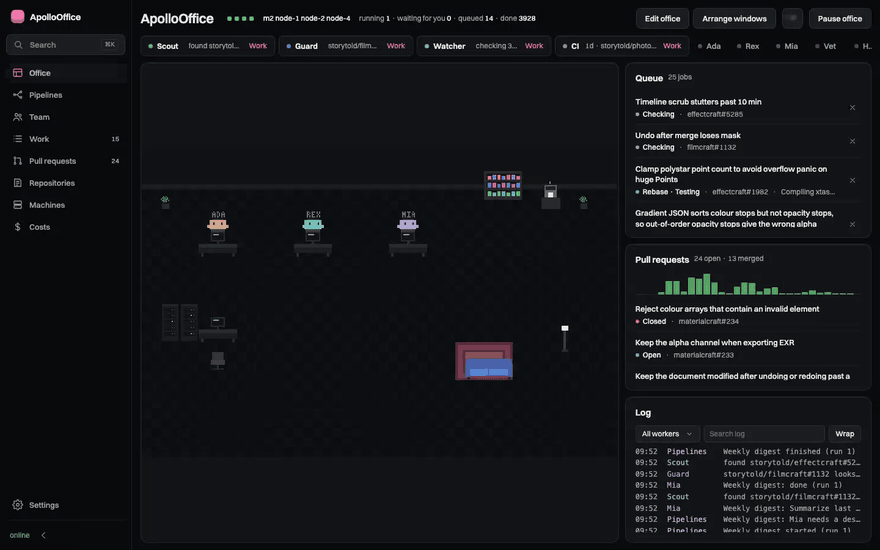
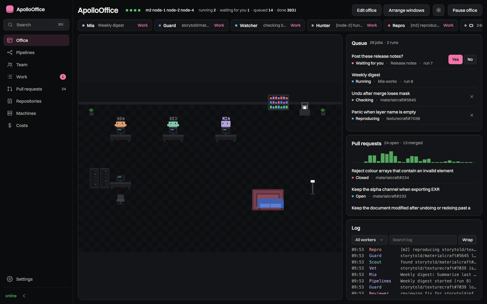
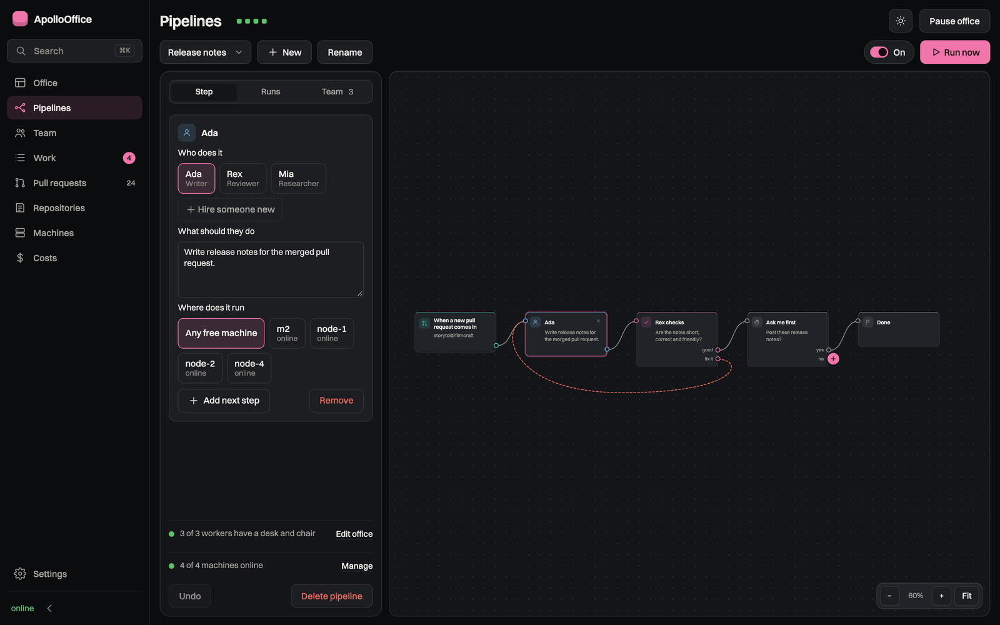
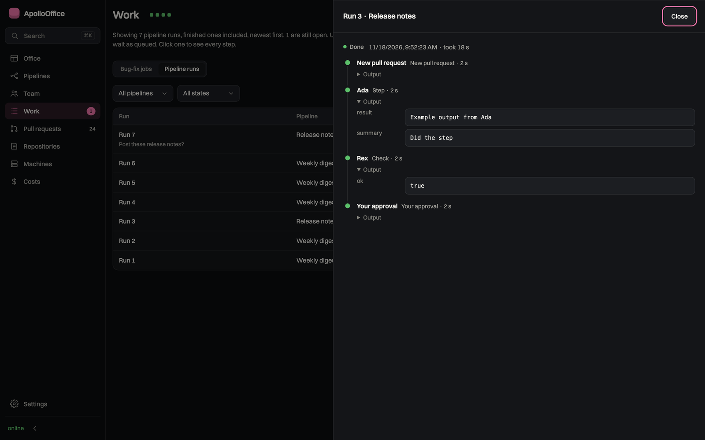
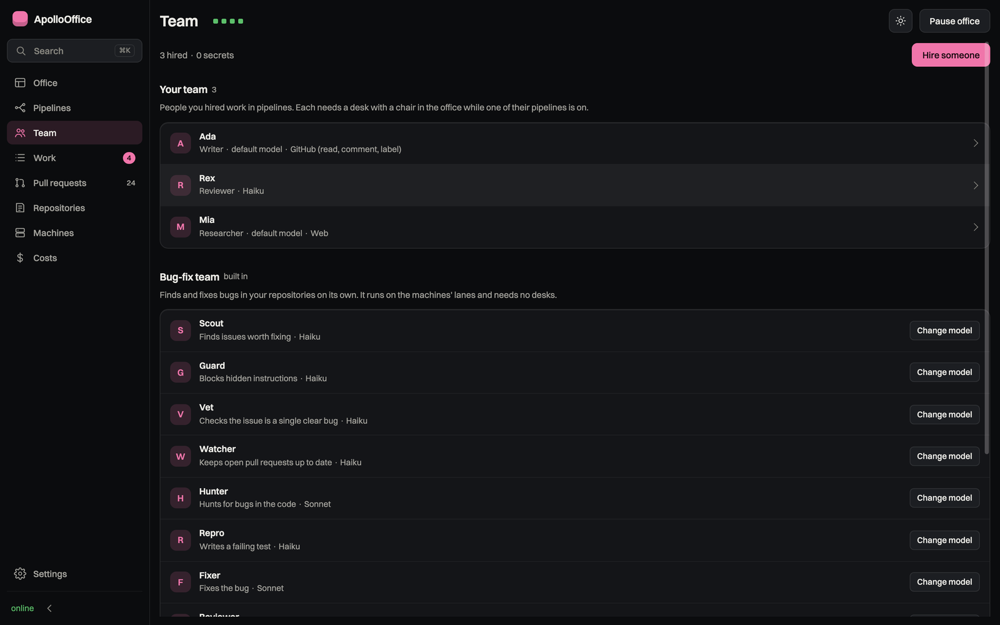
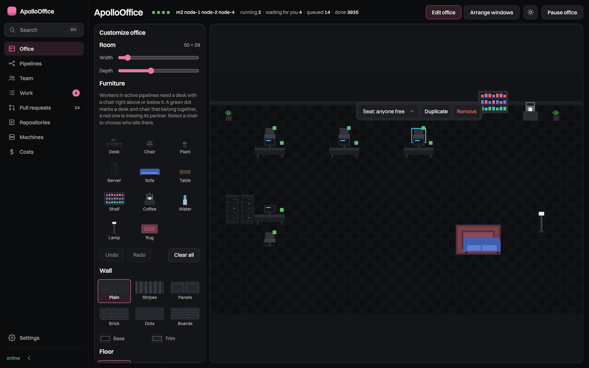
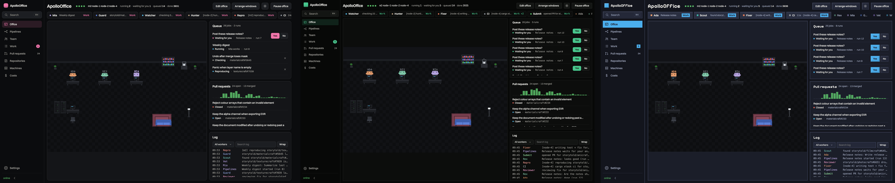

<h1 align="center">ApolloOffice Improved</h1>

> **Modified version.** ApolloOffice Improved is an independently developed fork of
> [ApolloOffice](https://github.com/Silvertree2010/ApolloOffice) by Silvertree2010,
> based on upstream v0.10.3 (November 2026). It is not affiliated with or endorsed by
> the original project. Licensed under the same terms, [AGPL-3.0](LICENSE).

<p align="center">
  A pixel office of AI workers that fixes bugs in your GitHub repositories and
  runs pipelines you build yourself, on your own machines with your own accounts.
</p>

<p align="center">
  <a href="https://github.com/Silvertree2010/ApolloOffice/actions/workflows/ci.yml"></a>
  <a href="https://github.com/Silvertree2010/ApolloOffice/releases/latest"></a>
  <a href="https://github.com/Silvertree2010/ApolloOffice/releases"></a>
  
  
  <a href="LICENSE"></a>
</p>

<p align="center"><a href="https://office.apollonet.dev">Website</a> · <a href="docs/media/tour.mp4">Video tour</a> · <a href="https://github.com/Silvertree2010/ApolloOffice/releases/latest">Download</a></p>

[](docs/media/tour.mp4)

ApolloOffice is a single binary with a web interface. Add a repository and the
built-in bug-fix team takes over: it finds or receives bug reports,
reproduces them, writes a fix with a regression test, proves the test fails
without the fix and passes with it, runs your tests and opens a pull request.
Next to it you can hire your own workers and wire them into pipelines for
anything else: release notes, triage, digests, research. Nothing runs on a
server of ours.

> [!WARNING]
> ApolloOffice is in beta. Expect bugs and please [report them](https://github.com/Silvertree2010/ApolloOffice/issues).

## The office



Every worker has a tile at the top and, if it belongs to a pipeline, a desk in
the room. The queue lists bug-fix jobs and pipeline runs together; questions
that wait for you have Yes and No right in the row. Pull requests and the log
sit below. Windows can be moved and resized with **Arrange windows**.

## Pipelines



A pipeline starts with a trigger (by hand, on a schedule, on a new issue or
pull request, or from a webhook) and continues with steps you click together:
a worker does a task, a check sends it back with feedback, a choice branches,
an approval asks you first. Steps that need a shell or files run on one of
your machines, in Docker unless you turn it off, and share its lanes with the
bug-fix team.



Every run keeps the output of each step. **Work → Pipeline runs** lists them;
a run that waits for you or for a desk says so and offers the next action.

## Team and desks



Hire workers from a catalog of roles or describe your own, pick a model and
what they may do (shell, files, GitHub, web), and give them secrets they may
use. Each hired worker in an active pipeline needs a desk with a chair in the
office. Place them in **Edit office**, where a green dot marks a desk and chair
that belong together, and select a chair to choose who sits there.



## Built-in bug-fix team

- **Scout, Guard and Vet** pick suitable issues and block hidden instructions.
  **Hunter** looks for bugs in the code itself.
- **Repro, Fixer, CI and Reviewer** write a failing test, fix the bug, run your
  test command and review the change. ApolloOffice itself checks that the
  test is red without the fix and green with it.
- **Submit** opens the pull request, **Watcher** follows it: merges, change
  requests and merge conflicts, which it rebases on its own.
- Every pull request waits for your approval by default, with diff, proof and
  editable text. A repository can be switched to submit on its own.
- **Feature mode** (off by default) lets the team build small, clearly
  specified feature requests test-first.

For free-model authors reviewed by a Codex or Claude subscription, see
[the free-first guide](docs/free-first.md).

## Everything else

- **Any provider per worker:** Claude Code or Codex with your own login,
  Claude, OpenAI or Gemini with an API key, or a local model through Ollama.
- **Machines:** this computer or any machine you reach with `ssh`, isolated in
  Docker. The GitHub token never leaves your computer.
- **Costs:** per repository, pipeline and model, a daily budget for API keys,
  and a hint when a cheaper model gets merged as often.
- **Three styles:** Calm, Dense and Pixel, each in dark and light.



## Install

You need `git` (on Windows: Git for Windows), the [GitHub CLI][gh] logged in
with `gh auth login`, and at least one provider: [Claude Code][cc] or Codex
logged in, an API key, or Ollama. Docker is recommended.

Download the binary for your system from the [latest release][rel] and run it:

```sh
apollo-office                 # prints a one-time login link
apollo-office login-link      # new login link (10 minutes)
apollo-office autostart on    # start at login (Windows, macOS, Linux)
apollo-office status
```

Options: `--port` (default 47300), `--data <folder>`. The setup walks you
through adding a machine, a repository and its test command.

## Ask the office

The front desk is off by default. Turn it on under **Settings → General →
Front desk**. While it is off, the **Ask the office** button and the boss are
hidden, and multi-milestone projects (Architect, Builder) wait in the queue.
The other workers keep running as usual.

Click **Ask the office** in the header and say what you need in your own
words. The front desk, a small AI model, works out what you mean and hands the
work to the right worker; after that the office carries on by itself.

| You say | Goes to |
|---|---|
| "Fix issue #12" | Vet, who reads the issue first |
| "The export command crashes on an empty file" | Repro, who reproduces the bug |
| "Add a --json flag to the list command" | Repro, who plans the feature |
| "Search this repo for bugs" | Hunter |

If something is unclear, for example which repository you mean, the front desk
asks before it starts anything. Hover any worker to read what it does.

On the office floor the front desk is the big boss in the black suit at the
entrance on the right. Click him to open the chat; he types while he works on
an answer.

He never starts work on his own. Each answer comes with a plan: one line per
job, the worker it goes to, and what starting it costs. Untick what you do not
want and press **Start**; nothing is queued before that. One plan can put work
on Vet, Repro, Fixer and Hunter at once and use their models' budget, so check
it first. If a bug or feature looks like a job that is already in the office,
the plan says so and leaves it unticked; tick it to start it anyway. Pressing
Start twice never creates the same job twice.

## API, MCP and webhooks

Create a token in **Settings → Integrations → API and MCP**, read-only or
allowed to change things. `GET /v2/openapi.json` lists every endpoint.

```sh
curl http://127.0.0.1:47300/v2/status -H "Authorization: Bearer $TOKEN"
claude mcp add apollo-office -e APOLLO_OFFICE_TOKEN=$TOKEN -- apollo-office mcp-server
```

MCP also works over HTTP at `http://127.0.0.1:47300/mcp`. A pipeline with a
webhook block gets its own link: `POST /v1/run/<pipeline>/<block>` with the key
in an `X-Hook-Key` header starts it with the request body as input. Bug
reports from your own tools go to `POST /v1/report`, and Sentry or GlitchTip
alerts arrive through a webhook link from Settings.

Failed GitHub Actions runs can report themselves:

```yaml
on:
  workflow_run: { workflows: [CI], types: [completed] }
jobs:
  report:
    if: github.event.workflow_run.conclusion == 'failure'
    runs-on: ubuntu-latest
    permissions: { actions: read }
    steps:
      - uses: cute-johnny/ApolloOfficeImproved/report@main
        with:
          url: ${{ secrets.APOLLO_OFFICE_URL }}
          token: ${{ secrets.APOLLO_OFFICE_TOKEN }}
```

## AI disclosure

Commits made by the bug-fix team carry `Co-Authored-By` trailers for the
models that worked on them, and every PR text says it was generated with AI by
ApolloOffice. This is always on: many projects require it.

## License

[AGPL-3.0](LICENSE)

Based on [ApolloOffice](https://github.com/Silvertree2010/ApolloOffice), copyright its
original authors. Changes made in this fork are released under the same license.

[gh]: https://cli.github.com
[cc]: https://claude.com/claude-code
[rel]: https://github.com/Silvertree2010/ApolloOffice/releases/latest
